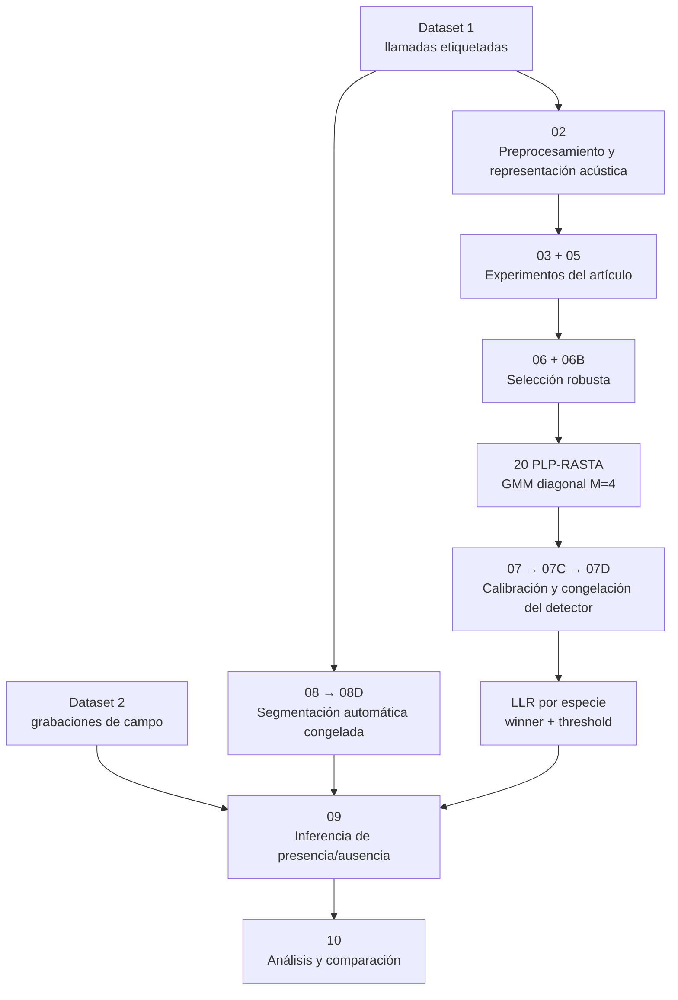
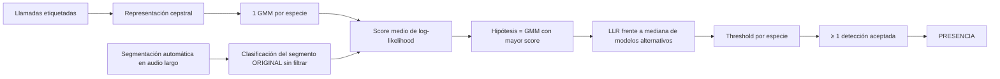
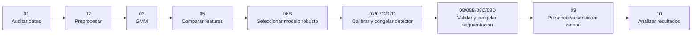

# Mapa conceptual de los notebooks y su relación con el artículo

> **Artículo base:** *Presence-absence estimation in audio recordings of tropical frog communities*  
> **Objetivo del proyecto:** replicar la **metodología** del artículo tan fielmente como permiten los datos recuperados, documentando de forma explícita las diferencias, decisiones de reconstrucción y mejoras de robustez.

>
> **Estado de la revisión (se actualiza por etapas).** Los notebooks 01 a 07 ya fueron auditados con la numeración nueva: `04_feature_comparison` es el antiguo `05_feature_comparision`, el antiguo `04_likelihood_ratio_calibration` está en `notebooks/archive/`, y `05_model_selection` reemplaza a `06_final_model_selection` y `06B_robust_model_selection` (también en `notebooks/archive/`, junto con el prototipo `05_field_presence_absence`), y `06_detector_calibration` reemplaza a `07`, `07B`, `07C` y `07D` (también archivados). `07_candidate_segmentation` reemplaza a `08`, `08B`, `08C` y `08D` (también archivados). Las filas y diagramas de abajo para el resto de los notebooks siguen la numeración antigua y aún no han sido auditados. En particular, la afirmación de que PLP-RASTA fue "más robusto" debe leerse con la advertencia de `04_feature_comparison`: su ventaja bajo el protocolo del artículo depende en gran parte de cómo arranca el filtro RASTA en cada llamada.

## Leyenda

- 🟩 **Reproducción directa:** implementa una etapa descrita explícitamente en el artículo.
- 🟨 **Adaptación metodológica:** mantiene la idea del artículo, pero cambia una decisión para evitar leakage, ajustarse a los datos recuperados o usar la configuración empíricamente más robusta.
- 🟦 **Diagnóstico / extensión:** experimento propio del proyecto; no aparece como tal en el artículo.
- ⬜ **Análisis / ingeniería:** organiza, congela o analiza resultados; no añade una nueva etapa conceptual del artículo.
- ❌ **Superado:** notebook intermedio o prototipo que ya no forma parte del pipeline final.

---

# 1. Diagrama general: artículo vs. notebooks

```mermaid
flowchart LR

    subgraph PAPER["ARTÍCULO"]
        P1["1. Datos<br/>llamadas etiquetadas + audio de campo"]
        P2["2. Extracción de características<br/>20 m-FCC"]
        P3["3. Experimentos GMM<br/>6/12/18 s + M=2..64"]
        P4["4. Comparación de features<br/>12 MFCC / 20 MFCC / PLP-RASTA / m-FCC"]
        P5["5. Clasificador final<br/>1 GMM por especie"]
        P6["6. Verificación<br/>LLR + ROC + threshold por especie"]
        P7["7. Segmentación automática<br/>30 s → FIR → STE 10 ms → MA=12 → 3/3"]
        P8["8. Campo<br/>segmento original → features → GMM → LLR"]
        P9["9. Presencia/ausencia<br/>≥1 llamada aceptada = presencia"]
        P10["10. Evaluación manual<br/>18 muestras etiquetadas"]

        P1 --> P2 --> P3 --> P4 --> P5 --> P6 --> P7 --> P8 --> P9 --> P10
    end

    subgraph PROJECT["NUESTRA RÉPLICA"]
        N01["01<br/>Data exploration<br/>🟩"]
        N02["02<br/>Preprocessing / m-FCC<br/>🟩"]
        N03["03<br/>GMM parameter investigation<br/>🟩"]
        N05["05<br/>Feature comparison<br/>🟩"]
        N06["06<br/>Final model selection<br/>🟨"]
        N06B["06B<br/>Robust model selection<br/>🟨"]
        N07["07<br/>Final detector calibration<br/>🟨"]
        N07B["07B<br/>f02 diagnostic<br/>🟦"]
        N07C["07C<br/>End-to-end thresholds<br/>🟨"]
        N07D["07D<br/>Freeze detector<br/>⬜"]
        N08["08<br/>Candidate segmentation<br/>🟨"]
        N08B["08B<br/>Endpoint-padding diagnostic<br/>🟦"]
        N08C["08C<br/>f04 padding end-to-end<br/>🟦"]
        N08D["08D<br/>Freeze segmentation<br/>⬜"]
        N09["09<br/>Field presence/absence<br/>🟩/🟨"]
        N10["10<br/>Field results analysis<br/>⬜"]

        N01 --> N02 --> N03 --> N05 --> N06 --> N06B --> N07
        N07 --> N07B --> N07C --> N07D
        N07D --> N08 --> N08B --> N08C --> N08D --> N09 --> N10
    end

    N01 -. "audita" .-> P1
    N02 -. "reproduce" .-> P2
    N03 -. "reproduce protocolo" .-> P3
    N05 -. "reproduce experimento" .-> P4
    N06B -. "elige configuración robusta" .-> P5
    N07 -. "implementa" .-> P6
    N08 -. "reconstruye" .-> P7
    N09 -. "ejecuta" .-> P8
    N09 -. "genera" .-> P9
    N10 -. "compara / discute" .-> P10
```

---

# 2. Pipeline final que realmente usamos

La idea importante es que hay **dos ramas que se preparan por separado** antes de tocar el audio de campo:

1. **Detector:** features → GMM → LLR → thresholds.
2. **Segmentador:** banda → STE → endpoints → candidatos.

En `09` ambas ramas se unen.

---

# 3. Notebook por notebook

| Notebook | Qué hace | Relación con el artículo | Diferencia principal |
|---|---|---|---|
| **01 — `data_exploration`** | Audita datasets, especies, archivos, duraciones, sample rates y disponibilidad real de las anotaciones. | 🟩 Corresponde a entender y reconstruir los datasets descritos en el artículo. | Nuestros archivos recuperados no coinciden exactamente en cantidad/contenido con los reportados. |
| **02 — `preprocessing`** | Convierte llamadas etiquetadas en vectores acústicos y crea `features.npy`, `labels.npy` y `calls.csv`. | 🟩 Implementa el frontend cepstral del artículo. | El artículo no publica todos los parámetros numéricos del banco m-FCC; algunos deben reconstruirse. |
| **03 — `gmm_parameter_investigation`** | Entrena un GMM por especie y prueba tiempos de entrenamiento `6, 12, 18 s` y `M={2,4,8,16,32,64}`; calcula WER. | 🟩 Reproduce directamente el experimento de selección de GMM del paper. | El paper favorece `M=64`; en los datos recuperados el óptimo inicial fue diferente. |
| **04 — calibración LLR inicial/fixed** | Primera implementación de GMM + LLR + ROC + thresholds. | 🟩/🟨 Sigue la verificación del artículo. | Quedó **superada** después de cambiar la representación final a PLP-RASTA y exigir validación por WAV. |
| **05 — `feature_comparison_NO_CHANGE_02`** | Compara `12 MFCC`, `20 MFCC`, `20 PLP-RASTA` y `20 m-FCC` con el mismo split y la misma rejilla de `M`. | 🟩 Replica la Sección 4.2 del artículo. | En el artículo gana m-FCC; en nuestros datos recuperados gana **PLP-RASTA**. |
| **06 — `final_model_selection`** | Profundiza la combinación PLP-RASTA × duración × número de gaussianas. | 🟨 Continúa el mismo tipo de experimento del paper. | Inicialmente usaba splits por llamada; resultó demasiado optimista. |
| **06B — `robust_model_selection`** | Repite la selección separando **WAV fuente completos** entre entrenamiento y validación. | 🟨 Mejora de robustez nuestra. | El artículo no especifica esta separación estricta. Selección final: **20 PLP-RASTA + M=4**. |
| **07 — `final_detector_calibration`** | Crea TRAIN/CALIBRATION por WAV, entrena GMMs finales, calcula scores, LLR y ROC por especie, y obtiene thresholds. | 🟩/🟨 Reproduce la idea GMM + likelihood-ratio + ROC del paper. | Nosotros usamos PLP-RASTA/M=4 y no reentrenamos después de calibrar; el paper final usa m-FCC/M=64 y ajuste posterior con campo anotado. |
| **07B — `f02_diagnostic`** | Investiga por qué `f02` tenía buen reconocimiento pero pésima aceptación con su threshold original. | 🟦 No es un experimento del artículo. | Descubre que el ROC one-vs-all estaba penalizando llamadas que nunca podían terminar como hipótesis `f02`. |
| **07C — `final_threshold_calibration`** | Recalibra thresholds usando la decisión que realmente ejecuta el detector: `winner == k AND LLR_k >= threshold`. | 🟨 Mantiene la filosofía de bajo FPR del paper, pero corrige nuestra implementación operativa. | Principal cambio: threshold de `f02`; no se retrenan GMMs. |
| **07D — `promote_final_detector`** | Archiva thresholds antiguos, promueve los nuevos y verifica hashes de los GMM. | ⬜ Ingeniería/reproducibilidad. | No corresponde a una etapa científica adicional del paper; simplemente congela el detector. |
| **08 — `candidate_call_segmentation`** | Reconstruye el frontend de segmentación y busca un `C` por especie usando Dataset 1. | 🟩/🟨 Reproduce 30 s + FIR + STE 10 ms + MA=12 + regla 3/3. | El artículo **no publica el valor de `C`** ni todos los detalles del FIR, así que los seleccionamos/explicitamos nosotros. |
| **08B — `endpoint_padding_diagnostic`** | Prueba si los malos endpoints de `f04` se deben a recorte temporal. | 🟦 Diagnóstico propio. | El padding no aparece en el artículo. |
| **08C — `f04_padding_end_to_end`** | Compara 0/10/20 ms de padding pasando los segmentos por PLP + GMM + LLR. | 🟦 Extensión propia. | Justifica **20 ms por lado para f04** por desempeño end-to-end. |
| **08D — `promote_segmentation_configuration`** | Congela `C` por especie y padding final. | ⬜ Ingeniería/reproducibilidad. | Padding de f04 queda documentado como extensión del proyecto. |
| **09 — `field_presence_absence`** | Aplica todo a los WAV de campo: segmenta, extrae PLP, calcula GMM, LLR, acepta detecciones y produce vector presencia/ausencia. | 🟩 Es la etapa final central del artículo. | Nosotros tenemos 9 especies modelables, más WAV disponibles y usamos PLP/M=4; el paper tenía 10 modelos y m-FCC/M=64. |
| **10 — `field_results_analysis`** | Resume presencia por especie, detecciones, LLR, bandas, pond/mes y compara metodológicamente con el paper. | ⬜ Equivale a nuestra etapa de análisis/discusión. | No calculamos accuracy/precision/recall de campo sin un ground truth completo equivalente a las 18 muestras manuales del paper. |

---

# 4. Qué partes siguen exactamente la idea del paper

Ese es el **núcleo conceptual** que queríamos replicar, y está conservado.

---

# 5. Principales diferencias entre el artículo y nuestra réplica

| Elemento | Artículo | Nuestra réplica | Motivo |
|---|---|---|---|
| Feature final | **20 m-FCC** | **20 PLP-RASTA** | PLP fue más robusto con nuestros datos recuperados. |
| GMM final | **M=64** | **M=4** | Selección con validación estricta por WAV favoreció un modelo más pequeño. |
| Especies finales | 10 | 9 | `f09` tiene material etiquetado insuficiente en el corpus recuperado. |
| Validación | Selección aleatoria/10-fold descrita de forma limitada | Separación estricta por WAV fuente | Evitar leakage entre llamadas de una misma grabación. |
| Thresholds | ROC one-vs-all + ajuste con campo anotado | Calibración con Dataset 1 y regla end-to-end | No tenemos el mismo conjunto completo usado para el fine-tuning de los autores. |
| `C` de segmentación | Empírico, valor no reportado | Seleccionado por especie sobre Dataset 1 | Parámetro faltante en el paper. |
| FIR exacto | No totalmente especificado | Reconstrucción explícita | Información insuficiente para una réplica byte-a-byte. |
| Padding | No reportado | `f04`: 20 ms por lado | Corrección diagnóstica propia de endpoints. |
| Audio de campo | 141 muestras / 23.5 h reportadas | 546 WAV procesados | Los datos disponibles no son exactamente los mismos; se replica la metodología. |
| Métricas de campo | 18 muestras manualmente etiquetadas | No hay métricas equivalentes completas | No convertir salida del detector en “ground truth”. |

---

# 6. Qué notebooks son realmente necesarios para contar la historia final

Si el objetivo es **explicar el proyecto** y no narrar cada desvío de depuración, la versión corta es:

En una exposición, los notebooks `07B`, `08B` y `08C` se explican como **diagnósticos que justificaron decisiones**, no como etapas nuevas del paper.

---

# 7. Resumen en una sola frase

> **El artículo propone:** aprender modelos acústicos de llamadas de rana, verificar cada detección con un likelihood ratio, localizar candidatos automáticamente en audio ambiental y convertir las llamadas aceptadas en presencia/ausencia por especie.  
>
> **Nuestra réplica conserva ese flujo completo**, pero selecciona PLP-RASTA + GMM M=4 mediante validación estricta por grabación, reconstruye los parámetros no publicados de segmentación y documenta explícitamente las extensiones necesarias para los datos recuperados.
