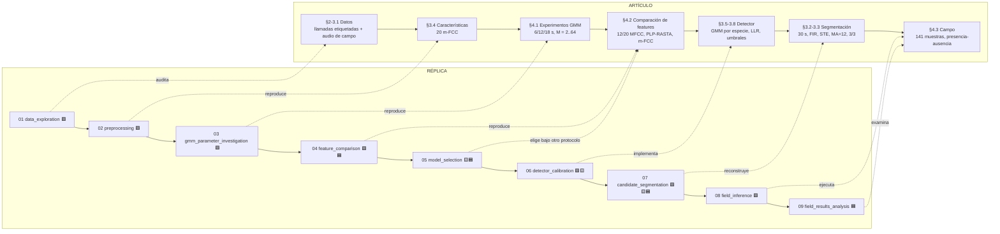

# Mapa de los notebooks y su relación con el artículo

> **Artículo base:** *Presence-absence estimation in audio recordings of tropical frog communities*  
> **Objetivo del proyecto:** replicar la **metodología** del artículo tan fielmente como permiten los datos recuperados, documentando de forma explícita las diferencias, las decisiones de reconstrucción y lo que los datos no permiten afirmar.
>
> **Estado:** los nueve notebooks fueron auditados y reconstruidos en orden, uno por etapa del artículo. El trabajo anterior (prototipos, diagnósticos y notebooks de "promoción") está en la rama `archive/previous-notebooks`. Cada notebook sigue la misma forma: pregunta de la sección, código, salida, hallazgos etiquetados (`[PAPER]`, `[SOURCE]`, `[OBSERVED]`, `[INFERENCE]`). Los números de cada hallazgo están impresos en la salida que los precede.

## Leyenda

- 🟩 **Reproducción directa:** implementa una etapa descrita explícitamente en el artículo.
- 🟨 **Adaptación o decisión propia:** mantiene la idea del artículo, pero una decisión que el artículo no toma (o toma de forma no reproducible) se resuelve aquí y se declara.
- 🟦 **Extensión:** análisis propio que no está en el artículo y se etiqueta como tal.

---

# 1. Diagrama: etapas del artículo y notebooks

El flujo de datos entre notebooks pasa por `data/processed/` y `models/`. Las piezas reutilizables viven en `src/frog_presence/` con pruebas: `audio`, `filenames`, `sidecars`, `features`, `gmm`, `detector`, `segmentation`, `field`, `inference` y `device`.

---

# 2. Notebook por notebook

| Notebook | Qué hace | Relación con el artículo | Hallazgo o diferencia principal |
|---|---|---|---|
| **01 — data_exploration** | Audita las tres colecciones: qué hay en disco, qué coincide con lo que describe el artículo y qué no se puede reconstruir. | 🟩 Datos (§2-3.1). | Las 141 muestras de prueba coinciden con el artículo (22.38 h, no 23.5 h). Faltan las etiquetas de las 18 muestras y el material de `f09`. |
| **02 — preprocessing** | De cada llamada anotada a 20 coeficientes cepstrales m-FCC por trama; escribe `features.npy`, `labels.npy` y `calls.csv` (con los límites de cada llamada). | 🟩 §3.4. | El banco de filtros modificado es una **estimación** a partir de la Figura 6(b). |
| **03 — gmm_parameter_investigation** | Un GMM diagonal por especie con 6/12/18 s de llamadas y M = 2..64, diez selecciones aleatorias; Tabla 2 y error ponderado (WER). | 🟩 §4.1. | Con 6 s el error sube con M (como en el artículo); con 12 y 18 s el mínimo está en M pequeño, no en 64. Con 12 s y M = 64: 1.528 % frente al 0.9 % del artículo. El 84-97 % de las llamadas de validación comparten grabación con el entrenamiento. |
| **04 — feature_comparison** | Compara 12 MFCC, 20 MFCC, PLP-RASTA y 20 m-FCC con las mismas particiones y semillas; reproduce también la Figura 8 (con 12 MFCC). | 🟩 §4.2 + 🟦 ablación del arranque de RASTA y validación por grabación. | El orden entre MFCC se reproduce; **m-FCC no supera a 20 MFCC**. La ventaja de PLP-RASTA bajo el protocolo del artículo depende en gran parte de cómo arranca el filtro RASTA en cada llamada; reteniendo grabaciones completas, RASTA baja el error de 18-34 % a 5-11 %. |
| **05 — model_selection** | Elige feature y número de gaussianas manteniendo grabaciones completas fuera del entrenamiento; compara con el protocolo por llamada. | 🟨 El artículo elige m-FCC con M = 64; aquí se elige bajo otro protocolo. | Con el protocolo por llamada el error es 0.2-2.4 %; con grabaciones separadas, 16-32 % (PLP-RASTA) y 39-48 % (m-FCC). Se elige **PLP-RASTA con M = 4** (≈ 8.5 %), con `f07` y `f04` débiles. |
| **06 — detector_calibration** | Congela un GMM por especie con partición TRAIN/CALIBRACIÓN por grabación; LLR contra la mediana de las alternativas y un umbral por especie. | 🟩 §3.5-3.8, 🟨 regla de umbral. | La regla ROC uno-contra-todos del artículo no sirve para la decisión que realmente se toma (acierta el modelo ganador **y** el LLR supera el umbral): `f02` pasa de 3/24 a 22/24 llamadas aceptadas. Cada umbral es la **llamada verdadera más débil** de la calibración y cambia mucho con la partición (hasta ±2.6 unidades). |
| **07 — candidate_segmentation** | Front end de segmentación sobre las grabaciones etiquetadas: bloques de 30 s, FIR por especie, STE de 10 ms, MA = 12, regla 3/3; mide cobertura de las llamadas anotadas para una rejilla de `C`. | 🟩 §3.2-3.3, 🟨 `C`, orden del FIR y lectura del umbral, 🟦 relleno de endpoints. | El artículo no da `C`: se elige por especie (recall primero). El front end conserva de 1 a 6 veces más audio que las llamadas anotadas y el 55 % de sus candidatos dura menos de 0.2 s. El relleno de 20 ms para `f04` solo se apoya en grabaciones usadas para entrenar. |
| **08 — field_inference** | Aplica segmentación y detector congelados a las **141 muestras** de los estanques; escribe candidatos, decisiones y presencia por especie. | 🟩 §4.3. | Procesa las 141 muestras (22.38 h, 579 540 candidatos). La presencia sale **saturada**: `f02` está en las 141 muestras, `f06` en 120 y `f03` en 100, y tres especies reciben el 97.5 % de los candidatos aceptados. |
| **09 — field_results_analysis** | Examina la salida: presencia por especie, estanque y fecha; qué acepta el detector; sensibilidad a los umbrales y a la duración mínima; y si la salida separa las muestras que, según sus sidecars, contienen una especie. | 🟦 No hay etiquetas de campo, así que no se calculan métricas como las del artículo. | `f02` no separa las muestras cuyo sidecar la nombra de las demás (AUC 0.547); `f03` sí (0.929). La presencia de `f04`, `f06` y `f10` depende de candidatos apenas por encima del umbral, y la de `f04` de candidatos de menos de 0.2 s. El estanque 1 tiene casi el doble de eventos que el 2, como en el artículo. |

---

# 3. Diferencias entre el artículo y la réplica

| Elemento | Artículo | Réplica | Motivo |
|---|---|---|---|
| Feature final | 20 m-FCC | 20 PLP-RASTA | El banco m-FCC es una estimación; bajo validación por grabación PLP-RASTA gana por mucho (16 % frente a 39 %). Su ventaja depende del arranque del filtro RASTA. |
| GMM final | M = 64 | M = 4 | Con grabaciones completas fuera del entrenamiento, el error crece con M. |
| Especies | 10 | 9 | `f09` no tiene material etiquetado suficiente (2 llamadas, 1.18 s). Se reporta `NA`, nunca ausencia. |
| Validación | Selección aleatoria de segmentos | Por llamada (03, 04) y por grabación (05, 06) | El protocolo por llamada deja que el 84-97 % de la validación comparta grabación con el entrenamiento. |
| Umbrales | ROC uno-contra-todos a FPR 5 % y ajuste manual con muestras de campo anotadas | Regla extremo a extremo calibrada con llamadas de ranas | Las muestras anotadas no se entregaron. Los negativos de la calibración son solo llamadas de otras especies, no ruido. |
| `C` de segmentación | Empírica, no reportada | Elegida por especie sobre las grabaciones etiquetadas | Parámetro ausente en el artículo. |
| Umbral de energía | `(max − media)/C`, ambiguo | `media + (max − media)/C` por bloque de 30 s | Lectura explícita de una expresión que no es un nivel en dB. |
| Relleno de endpoints | No existe | `f04`: 20 ms por lado | Extensión del proyecto; apoyo débil (ver 07). |
| Audio de campo | 141 muestras de 10 min | Las mismas 141 (22.38 h) | Se seleccionan por el nombre `ccNNNx_SPn`; una versión anterior procesaba 546 archivos, incluidos extractos cortos. |
| Métricas de campo | 18 muestras etiquetadas a mano | No se calculan | Los vectores completos no se entregaron. Un sidecar que nombra una especie es evidencia positiva, no una etiqueta completa. |

---

# 4. Cómo leer los resultados

- **Los números del protocolo del artículo (03, 04) y los de la selección (05, 06) no son comparables entre sí.** Los primeros miden reconocer especies en grabaciones ya oídas en parte; los segundos, en grabaciones nuevas, que es la situación del campo.
- **El detector se calibró solo con llamadas de ranas.** Sus umbrales no dicen nada sobre cuánto ruido dejan pasar, y en un estanque casi todo candidato es otra cosa.
- **La salida de campo no es una medida de acierto.** 09 muestra cuánto depende cada conclusión de decisiones tomadas sin etiquetas de campo, sin elegir ni recomendar ninguna de ellas.

---

# 5. En una frase

> **El artículo propone:** aprender modelos acústicos de llamadas de rana, verificar cada detección con un cociente de verosimilitudes, localizar candidatos automáticamente en audio ambiental y convertir las llamadas aceptadas en presencia-ausencia por especie.  
>
> **La réplica conserva ese flujo completo**, lo ejecuta sobre las mismas 141 muestras, y documenta con evidencia dónde las decisiones del artículo (o su falta) cambian el resultado: el protocolo de validación, el arranque del filtro RASTA, la regla de umbral y la segmentación.
